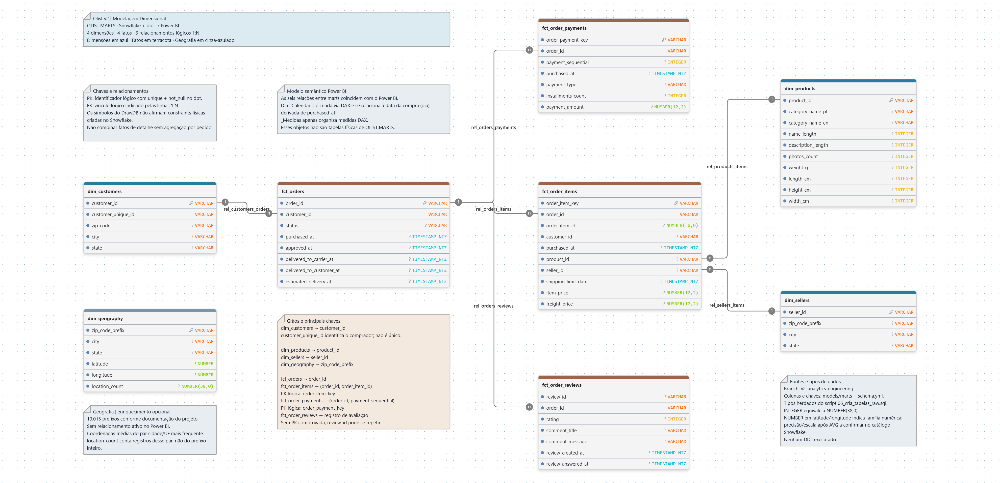
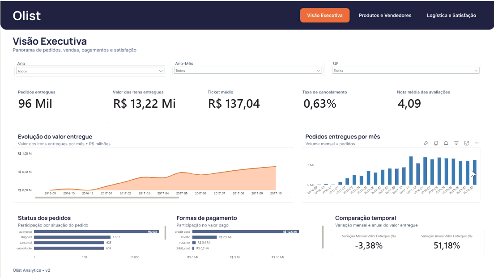
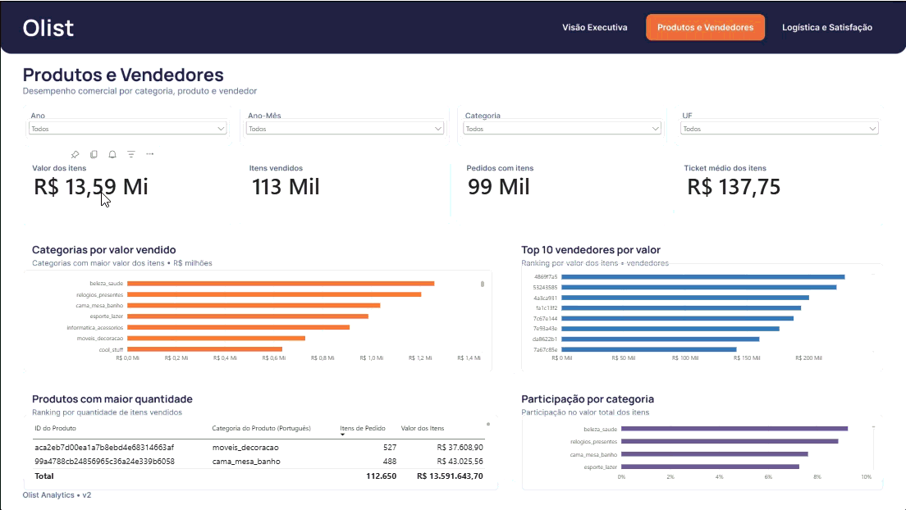
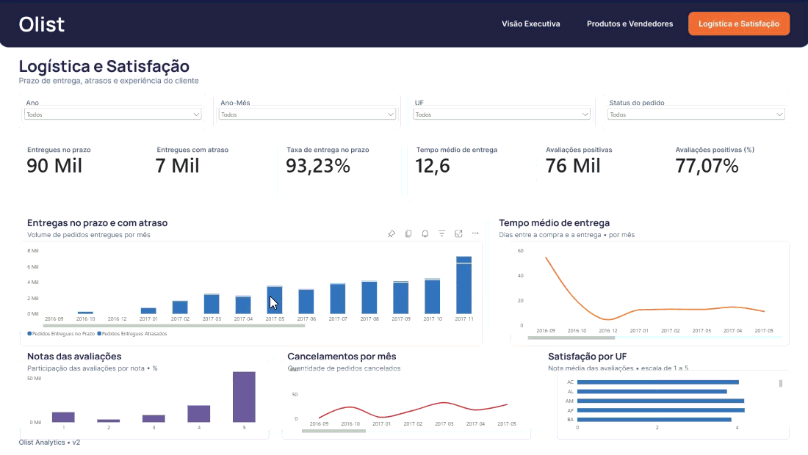

# Olist V2 — Analytics Engineering

Projeto de Analytics Engineering para transformar o Brazilian E-Commerce Public
Dataset by Olist em uma base analítica no Snowflake, documentada e testada com
dbt, e em um modelo semântico versionável no Power BI.

## 1. Objetivo do projeto

Construir uma camada analítica confiável para explorar pedidos, itens,
pagamentos, avaliações, produtos, vendedores, clientes e geografia, mantendo
explícitos os grãos dos fatos e as regras de qualidade.

## 2. Problema de negócio

O marketplace precisa acompanhar volume de pedidos, valor dos itens,
desempenho de produtos e vendedores, distribuição regional, logística e
satisfação. A solução separa esses temas em fatos e dimensões para reduzir
ambiguidade e evitar que joins entre itens, pagamentos e avaliações dupliquem
valores.

## 3. Arquitetura de dados


```text
CSV do Kaggle
  -> Stage interno Snowflake
  -> OLIST.RAW (9 tabelas)
  -> OLIST.STAGING (9 views dbt)
  -> OLIST.INTERMEDIATE (1 view)
  -> OLIST.MARTS (8 tabelas)
  -> Power BI (modelo Import e relatório PBIP)
```

Staging e intermediate são views; marts são tabelas. A macro
[`generate_schema_name.sql`](macros/generate_schema_name.sql) mantém os nomes
de schema definidos no projeto.

## 4. Fontes de dados

São utilizados os nove CSVs do
[Brazilian E-Commerce Public Dataset by Olist](https://www.kaggle.com/datasets/olistbr/brazilian-ecommerce):
customers, orders, order items, order payments, order reviews, products,
sellers, geolocation e product category name translation. Os arquivos não são
distribuídos neste repositório.

## 5. Pipeline e transformação

Os scripts em [`snowflake_scripts/`](snowflake_scripts/) criam o banco, role,
stage, formato de arquivo e tabelas RAW, e carregam os CSVs. Os modelos dbt
seguem `source -> cleaned -> renamed -> final`, com padronização de textos,
nomes de colunas, categorias e datas. A execução é sob demanda; não há
orquestração contínua implementada.

### Modelagem física da camada RAW

[](<modelagem_fisica/Diagrama Modelagem Física Olist v2.png>)

A camada `OLIST.RAW` contém **9 tabelas e 52 colunas**, preservando a estrutura
dos CSVs de origem. O diagrama e o
[SQL de referência](modelagem_fisica/olist-v2-modelagem-fisica.sql) seguem os
nomes, tipos e nulabilidade do
[`script de criação RAW`](snowflake_scripts/06_cria_tabelas_raw.sql): textos
em `VARCHAR`, datas em `TIMESTAMP_NTZ`, valores monetários em `NUMBER(12,2)` e
coordenadas em `NUMBER(38,20)`.

O DDL versionado não declara PK, FK, `UNIQUE`, `NOT NULL`, `CHECK`, colunas
de identidade ou índices; todos os campos admitem nulos. As **7 ligações do
diagrama são associações lógicas de consulta**, com cardinalidades de
referência, sem afirmar constraints físicas ou integridade referencial
implementada no Snowflake.

`ORDER_REVIEWS` preserva os registros de avaliação sem presumir unicidade de
`review_id`. `GEOLOCATION` permanece isolada porque o prefixo de CEP pode se
repetir; sua consolidação por prefixo ocorre no mart `dim_geography`.
A associação entre produtos e traduções não pressupõe tradução para todas as
categorias. A RAW não contém as colunas técnicas `review_row_id` ou
`geolocation_id`.

Abra a imagem para consultar os detalhes ou importe o
[JSON editável](modelagem_fisica/olist-v2-modelagem-fisica.json) em um diagrama
Snowflake no DrawDB. Essa documentação reflete os scripts versionados; nenhuma
estrutura do banco foi alterada durante a revisão.

## 6. Modelagem dimensional

O projeto contém **8 marts**: quatro dimensões (`dim_customers`,
`dim_products`, `dim_sellers`, `dim_geography`) e quatro fatos (`fct_orders`,
`fct_order_items`, `fct_order_payments`, `fct_order_reviews`).

O **modelo dimensional é híbrido**: combina dimensões analíticas com fatos
organizados em **cabeçalho e detalhes do pedido**. `fct_orders` representa o
cabeçalho, com uma linha por pedido, e se relaciona em **1:N** com os fatos de
itens, pagamentos e avaliações. Essa organização explica a interconexão entre
tabelas fato e preserva o grão próprio de cada processo.

### Diagrama dos marts

[](modelagem_dimensional/modelagem_dimensional.png)

O diagrama foi construído no DrawDB a partir dos SQLs de
[`models/olist/marts/`](models/olist/marts/), dos testes em
[`marts_schema.yml`](models/olist/marts/marts_schema.yml) e dos tipos definidos no
[`script de criação das tabelas RAW`](snowflake_scripts/06_cria_tabelas_raw.sql).
Abra a imagem para consultar as colunas em alta resolução.

`fct_orders` conecta clientes aos fatos de itens, pagamentos e avaliações.
Produtos e vendedores se relacionam com itens. As seis relações são lógicas,
validadas no dbt; os símbolos PK/FK não afirmam constraints físicas criadas no
Snowflake. `fct_order_reviews` permanece sem PK, pois `review_id` pode se repetir.

`dim_geography` fica isolada, com 19.015 prefixos conforme a documentação do
projeto, disponível para enriquecimento geográfico opcional. O Power BI
acrescenta o relacionamento com `Dim_Calendario`, criada via DAX e associada à
data da compra (dia); `_Medidas` apenas organiza medidas. Esses dois objetos
não são marts físicos.

Arquivos do diagrama: [PNG](modelagem_dimensional/modelagem_dimensional.png),
[JSON editável no DrawDB](modelagem_dimensional/olist-v2-modelagem-dimensional.json)
e [SVG](modelagem_dimensional/olist-v2-modelagem-dimensional.svg).
Para editar, importe o JSON no DrawDB. A precisão e a escala finais de
`latitude` e `longitude` após `AVG` ainda precisam de confirmação no catálogo
Snowflake; no diagrama, `NUMBER` indica apenas a família numérica desses campos.

### Grãos dos modelos

| Modelo | Grão |
| --- | --- |
| `dim_customers` | `customer_id` |
| `dim_products` | `product_id` |
| `dim_sellers` | `seller_id` |
| `dim_geography` | prefixo de CEP |
| `fct_orders` | `order_id` |
| `fct_order_items` | `(order_id, order_item_id)` |
| `fct_order_payments` | `(order_id, payment_sequential)` |
| `fct_order_reviews` | registro de avaliação da origem |

Os relacionamentos entre cabeçalho e detalhes permitem navegar pelo pedido.
Para combinar medidas de itens, pagamentos e avaliações em uma consulta no
grão de pedido, agregue cada fato separadamente por `order_id` antes de unir
os resultados, evitando multiplicação de linhas e valores.

## 7. Tecnologias utilizadas

- Snowflake: armazenamento RAW e execução dos modelos.
- dbt: transformação, documentação e testes.
- Power BI: modelo semântico e dashboard.
- PBIP/PBIR/TMDL: formato versionável do relatório e do modelo.
- Git/GitHub: versionamento do projeto.

## 8. Estrutura do repositório

Principais pastas e arquivos da estrutura atual:

```text
Projeto_Olist_v2/
├── analyses/
│   ├── exploracao_customers.sql
│   └── powerbi_validacao/                 # Consultas, resultados e conferências
│       ├── 00_controle.dax
│       ├── 00_controle.tsv
│       ├── 01_consultas_pendentes.dax
│       ├── 01_resultados.tsv
│       ├── conferir_resultados.py
│       ├── proveniencia.json
│       ├── resultados_estruturados.json
│       ├── validacao_insights.ipynb
│       └── README.md
├── assets/
│   ├── backgrounds/                      # Fundos das três páginas do relatório
│   └── dashboard/                        # Prévias animadas do relatório
│       ├── 01-visao-executiva.gif
│       ├── 02-produtos-vendedores.gif
│       └── 03-logistica-satisfacao.gif
├── docs/
│   ├── arquitetura-de-dados-olist-v2.png
│   ├── insights-negocio.md
│   └── template-analise-projeto-olist-v2.pdf
├── macros/
│   └── generate_schema_name.sql
├── modelagem_dimensional/                # Modelo híbrido dos marts
│   ├── modelagem_dimensional.png
│   ├── olist-v2-modelagem-dimensional.json
│   └── olist-v2-modelagem-dimensional.svg
├── modelagem_fisica/                     # Estrutura da camada RAW
│   ├── Diagrama Modelagem Física Olist v2.png
│   ├── olist-v2-modelagem-fisica.json
│   └── olist-v2-modelagem-fisica.sql
├── models/
│   └── olist/
│       ├── staging/                      # 9 modelos SQL, fontes e testes YAML
│       ├── intermediate/                 # int_olist_customers.sql e testes YAML
│       └── marts/                        # 4 dimensões, 4 fatos e marts_schema.yml
├── powerbi/
│   ├── Olist_Analytics_v2.pbip
│   ├── Olist_Analytics_v2.Report/
│   │   ├── definition/                   # Páginas e visuais PBIR
│   │   └── StaticResources/              # Recursos visuais e temas
│   └── Olist_Analytics_v2.SemanticModel/
│       ├── DAXQueries/                   # Consultas salvas no Power BI
│       └── definition/                   # Tabelas, medidas e relações TMDL
├── snowflake_scripts/                    # Scripts 01 a 07: setup, RAW e carga
├── tests/                                # Espaço para testes singulares dbt
├── .gitignore
├── dbt_project.yml
└── README.md
```

As pastas locais `.git/`, `.vscode/`, `venv/`, `target/`, `logs/` e `.pbi/`
foram omitidas desta visão. As regras de exclusão estão em [`.gitignore`](.gitignore).

## 9. Qualidade e testes dbt

Os YAMLs declaram testes `not_null`, `unique`, `relationships` e
`accepted_values`. Na validação registrada em 22/10/2026, `dbt test` executou
**56 testes: 56 pass, 0 fail**. A execução selecionada de intermediate e marts
materializou uma view e oito tabelas, com 25 testes associados aprovados.

Os 56 resultados foram verificados na execução local do dbt. `target/` e
`logs/` são artefatos locais ignorados pelo Git e não fazem parte da entrega;
para reproduzir a validação, execute a suíte completa com `dbt test`.

## 10. Modelo semântico do Power BI

O modelo é Import e lê os oito marts no Snowflake. O PBIP contém **35 medidas
DAX** centralizadas em `_Medidas`, **7 relacionamentos ativos** e um calendário
relacionado à **data da compra**. O arquivo `definition.pbir` referencia o
modelo por caminho relativo, mantendo o projeto reconstruível.

As medidas distinguem pedidos, itens, pagamentos e avaliações. `Valor dos
Itens` não representa automaticamente receita líquida; pagamentos não devem
ser somados após um join direto com itens.

## 11. Dashboard

O relatório possui três páginas:

1. **01 — Visão Executiva:** volume de pedidos, valor dos itens e evolução.
2. **02 — Produtos e Vendedores:** categorias, itens e desempenho de vendedores.
3. **03 — Logística e Satisfação:** prazo de entrega, atrasos e avaliações.

Prévias animadas das três páginas do relatório:

### Visão Executiva



### Produtos e Vendedores



### Logística e Satisfação



## 12. Principais indicadores e insights

As métricas principais são pedidos registrados, pedidos entregues e
cancelados, valor dos itens, frete, pagamentos, ticket médio dos itens, taxa
de entrega no prazo, tempo médio de entrega, nota média e taxa de avaliações
positivas.

Entre os resultados já verificados: 99.441 pedidos, 112.650 itens, 103.886
pagamentos e 99.224 avaliações; preço dos itens de R$ 13.591.643,70; frete de
R$ 2.251.909,54; e pagamentos de R$ 16.008.872,12. Pagamentos excedem itens
mais frete em R$ 165.318,88 no conjunto completo, evidenciando que esses
conceitos não devem ser tratados como receita sem regra aprovada.

Os insights detalhados, incluindo resultados, limitações e fontes, estão em
[`docs/insights-negocio.md`](docs/insights-negocio.md). As sete análises de
evolução mensal, categorias, vendedores, UFs, logística,
satisfação e associação atraso-nota foram verificadas em 23/10/2026 no modelo
Import aberto do Power BI. Consultas, resultados e conferências estão em
[`analyses/powerbi_validacao/`](analyses/powerbi_validacao/). A verificação
descreve o snapshot carregado e não confirma atualização recente do Snowflake.

## 13. Como executar ou explorar

1. Obtenha os nove CSVs no Kaggle e envie-os para
   `@OLIST.RAW.OLIST_CSV_STAGE`.
2. Execute os scripts de [`snowflake_scripts/`](snowflake_scripts/) na ordem
   indicada, ajustando permissões ao ambiente.
3. Configure externamente o perfil dbt `default` com Snowflake, banco `OLIST`,
   warehouse `OLIST_WH` e role `OLIST_DBT_ROLE`.
4. Compile, construa e teste:

```bash
dbt compile --select path:models/olist/intermediate path:models/olist/marts
dbt build --select path:models/olist/intermediate path:models/olist/marts
dbt test --select path:models/olist/staging
dbt test
```

5. Abra [`Olist_Analytics_v2.pbip`](powerbi/Olist_Analytics_v2.pbip) no Power BI
   Desktop com acesso ao Snowflake e atualize o modelo antes de explorar os
   visuais. Não versionar credenciais no perfil dbt ou no projeto Power BI.

## 14. Limitações conhecidas

- O dataset é histórico e estático; não há ingestão contínua nem Airflow.
- 2016 e 2018 são períodos incompletos.
- O calendário usa a data da compra, não a entrega ou a avaliação.
- Valor dos itens, frete e pagamentos têm significados e grãos diferentes.
- `customer_unique_id` e `review_id` não são chaves únicas nos fatos
  correspondentes.
- A diferença de notas observada entre entregas no prazo e atrasadas é
  associativa e não demonstra causalidade.
- Credenciais, CSVs e resultados de execução não fazem parte do repositório.

## 15. Melhorias futuras

- Definir com o negócio receita, população de pedidos e regras de cancelamento.
- Atualizar o modelo e repetir as análises e reconciliações quando a base mudar.
- Adicionar testes singulares para regras financeiras e cobertura temporal.
- Automatizar atualização e monitoramento do pipeline.
- Acrescentar análise de recompra, coortes, SLA por vendedor e comentários.

## Autor

Desenvolvido por **Isaias Santos**.

- [LinkedIn](https://www.linkedin.com/in/isaiassousadossantos/)
- [Meu site / portfólio](https://isaiassantos.works/)
