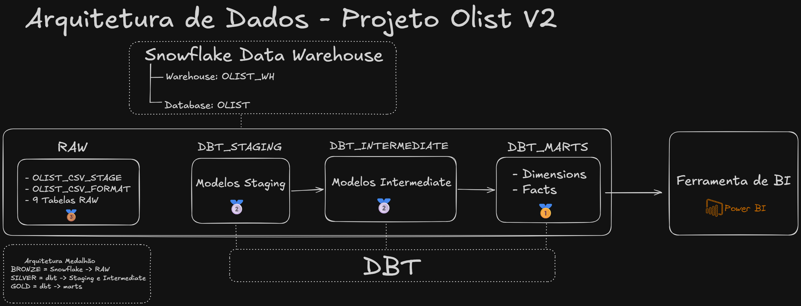

# E-commerce Olist - V2

Projeto prático de **Analytics Engineering**, com ingestão no Snowflake, transformações em SQL e testes de qualidade no dbt.

[](https://www.snowflake.com/)
[](https://www.getdbt.com/)
[](https://docs.snowflake.com/en/sql-reference)
[](https://git-scm.com/)

> **Em desenvolvimento:** nove modelos de staging implementados e 25 testes de dados declarados. As camadas intermediate e marts e o consumo no Power BI são as próximas etapas.

## Sobre o Projeto

O Olist V2 evolui o [projeto de análise de e-commerce da V1](https://github.com/isaiassousa032/Projeto_Olist/tree/main), ampliando o foco para a construção da base analítica que sustenta os indicadores de negócio.

A proposta é organizar o caminho entre os arquivos brutos e o consumo no Power BI: preservar a origem dos dados, separar as responsabilidades de cada camada, padronizar os campos e validar regras de qualidade por meio de código versionado.

O domínio continua sendo a operação de um marketplace: clientes, pedidos, itens, pagamentos, avaliações, produtos, vendedores e geolocalização. A implementação atual concentra-se na ingestão e na preparação dessas entidades.

### Evolução em relação à V1

| Aspecto | V1 | Direção da V2 |
| --- | --- | --- |
| Armazenamento | PostgreSQL hospedado no Neon | Snowflake |
| Preparação dos dados | Power Query | Modelos SQL no dbt, executados no Snowflake |
| Organização | Modelagem voltada ao relatório no Power BI | Camadas RAW, staging, intermediate e marts |
| Qualidade | Tratamentos e validações no fluxo analítico | Testes de dados declarados junto à documentação dos modelos |
| Visualização | Dashboard publicado no Power BI | Consumo dos futuros marts no Power BI |

O [dashboard interativo da V1](https://app.powerbi.com/view?r=eyJrIjoiZWM5YzNlNDQtZjMyZi00NDNmLThlODYtOTlmMjQ0MmJlZmY0IiwidCI6IjQwNTBmNTliLTViYTItNGEwOS04NDU4LWI2MjUwOWM0Yzk3ZCJ9) permanece como referência das visões de negócio. A V2 ainda não possui dashboard próprio publicado.

## Fonte dos Dados

O projeto utiliza os nove arquivos CSV do [Brazilian E-Commerce Public Dataset by Olist, disponível no Kaggle](https://www.kaggle.com/datasets/olistbr/brazilian-ecommerce).

| Tabela RAW | Conteúdo e granularidade considerada |
| --- | --- |
| `CUSTOMERS` | Registro por `customer_id`; `customer_unique_id` identifica o comprador entre compras. |
| `ORDERS` | Registro por pedido, com status e datas do ciclo de compra e entrega. |
| `ORDER_ITEMS` | Registro por item sequencial dentro do pedido. |
| `ORDER_PAYMENTS` | Registro por sequência de pagamento dentro do pedido. |
| `ORDER_REVIEWS` | Registros de avaliações; um pedido pode ter mais de uma avaliação. |
| `PRODUCTS` | Registro por produto, com categoria e atributos descritivos e físicos. |
| `SELLERS` | Registro por vendedor. |
| `GEOLOCATION` | Registros geográficos por prefixo de CEP, que pode se repetir. |
| `PRODUCT_CATEGORY_NAME_TRANSLATION` | Correspondência entre categorias em português e inglês. |

A fonte é um conjunto histórico estático. O fluxo atual utiliza carga de arquivos e execução dos modelos sob demanda, sem ingestão contínua ou orquestração com Airflow implementadas.

## Arquitetura e Engenharia de Dados



```text
CSV do Kaggle
    → Stage interno no Snowflake
    → OLIST.RAW — tabelas com os dados de origem
    → OLIST.STAGING — nove views de preparação, gerenciadas pelo dbt
    → OLIST.INTERMEDIATE — integrações e regras intermediárias [planejado]
    → OLIST.MARTS — fatos e dimensões para consumo analítico [planejado]
    → Power BI — indicadores e visualizações da V2 [planejado]
```

As configurações estão em [dbt_project.yml](dbt_project.yml). Staging e intermediate estão configuradas para materialização como **views**; marts, como **tabelas**. A declaração da camada não significa que seus modelos já estejam implementados.

A macro [generate_schema_name.sql](macros/generate_schema_name.sql) utiliza diretamente o nome de schema configurado para cada camada, sem acrescentar o prefixo de `target.schema`. Para separar ambientes que usam esses mesmos nomes, é necessário considerar também o banco de destino.

### Etapas do desenvolvimento

1. **Infraestrutura e acesso:** scripts para criação do banco `OLIST`, schema `RAW`, warehouse `OLIST_WH` e papel `OLIST_DBT_ROLE`.
2. **Ingestão:** stage interno, formato CSV com leitura de cabeçalhos, inspeção com `INFER_SCHEMA` e carga com `COPY INTO` e `MATCH_BY_COLUMN_NAME`.
3. **Modelagem física:** diagrama e SQL de referência para entidades, chaves, relacionamentos e granularidades.
4. **Staging:** nove modelos SQL para limpeza de textos, padronização de campos e renomeação de colunas.
5. **Qualidade e documentação:** descrições e testes de dados centralizados em `models/schema.yml`.
6. **Próximas etapas:** integrações em intermediate, modelagem dimensional em marts e consumo no Power BI.

## Transformações com dbt

Os modelos de staging seguem a sequência de CTEs `source → cleaned → renamed → final`, separando a leitura da origem, os tratamentos, os aliases e a seleção de saída.

Entre os tratamentos implementados estão:

- Remoção de espaços em identificadores e textos com `TRIM`.
- Padronização de caixa em status, categorias, cidades e UFs com `LOWER`, `UPPER` e `INITCAP`, conforme o modelo.
- Conversão de comentários vazios de avaliações em `NULL` com `NULLIF`.
- Renomeação de campos para nomes de consumo mais claros, como `order_status → status`, `order_purchase_timestamp → purchased_at`, `payment_value → payment_amount` e `review_score → rating`.
- Correção dos nomes de origem `product_name_lenght` e `product_description_lenght` para `name_length` e `description_length` na saída do staging.

| Modelo | Responsabilidade |
| --- | --- |
| `stg_olist_customers` | Preparar identificadores e localização dos clientes. |
| `stg_olist_orders` | Padronizar status e nomes das datas do pedido. |
| `stg_olist_order_items` | Preparar identificadores, preço do item e valor do frete. |
| `stg_olist_order_payments` | Padronizar modalidade, parcelas e valor do pagamento. |
| `stg_olist_order_reviews` | Preparar notas, comentários e datas das avaliações. |
| `stg_olist_products` | Padronizar categorias e nomes dos atributos dos produtos. |
| `stg_olist_sellers` | Preparar identificadores e localização dos vendedores. |
| `stg_olist_geolocation` | Padronizar nomes de campos geográficos e textos de localização. |
| `stg_olist_product_category_name_translation` | Padronizar categorias em português e inglês. |

As nove fontes estão declaradas em [_src_olist.yml](models/staging/olist/_src_olist.yml), com origem em `OLIST.RAW`.

## Qualidade dos Dados

O arquivo [models/schema.yml](models/schema.yml) contém **25 testes de dados** distribuídos pelos nove modelos de staging:

| Tipo | Quantidade | Regra verificada |
| --- | --- | --- |
| `not_null` | 18 | Preenchimento de identificadores e outros campos obrigatórios. |
| `unique` | 5 | Unicidade dos identificadores de clientes, pedidos, produtos, vendedores e da categoria em português na tradução. |
| `accepted_values` | 2 | Valores permitidos para status dos pedidos e notas das avaliações. |

O domínio de `status` contempla `delivered`, `invoiced`, `shipped`, `canceled`, `unavailable`, `processing`, `created` e `approved`. As notas em `rating` devem estar entre **1 e 5**.

Os testes expressam as regras implementadas; seus resultados dependem da execução contra os dados do ambiente. `accepted_values` verifica os valores não nulos, enquanto `not_null` verifica o preenchimento. Veja a [documentação dos testes dbt](https://docs.getdbt.com/reference/resource-properties/data-tests).

As validações de carga em [07_carga_tabelas_raw.sql](snowflake_scripts/07_carga_tabelas_raw.sql) também incluem contagens das nove tabelas e consultas de unicidade e nulidade para identificadores de clientes, pedidos, produtos e vendedores.

### Cuidados de modelagem

- **Cliente e comprador:** `customer_id` e `customer_unique_id` têm papéis diferentes; não se exige unicidade de `customer_unique_id` no staging de clientes.
- **Itens e pagamentos:** as granularidades são, respectivamente, `(order_id, order_item_id)` e `(order_id, payment_sequential)`. A unicidade dessas combinações ainda não está coberta pelos testes atuais.
- **Geolocalização:** o prefixo de CEP não é uma chave única. Sua consolidação precisa de uma regra explícita antes de joins que dependam de uma linha por prefixo.
- **Avaliações:** não se presume unicidade de `review_id` ou uma única avaliação por pedido.
- **Agregações:** integrar itens, pagamentos e avaliações exige controlar a cardinalidade para evitar multiplicação de valores.

## Modelagem Física

O diagrama registra a estrutura relacional de referência do domínio e os relacionamentos entre as entidades.


O [SQL da modelagem física](modelagem_fisica/olist-v2-modelagem-fisica.sql) inclui chaves, restrições, índices e chaves técnicas para geolocalização e avaliações. Ele é um artefato de referência relacional e contém instruções, como `CREATE INDEX`, que não devem ser tratadas como o DDL de implantação das tabelas RAW no Snowflake. O DDL usado para essa camada está em [06_cria_tabelas_raw.sql](snowflake_scripts/06_cria_tabelas_raw.sql).

## Estrutura do Repositório

```text
Projeto_Olist_v2/
├── analyses/                         # Consulta exploratória de clientes
├── docs/                             # Imagem da arquitetura de dados
├── macros/
│   └── generate_schema_name.sql      # Nomes dos schemas por camada
├── modelagem_fisica/                 # Diagrama e SQL de referência
├── models/
│   ├── schema.yml                    # Documentação e 25 testes de staging
│   ├── staging/olist/
│   │   ├── _src_olist.yml             # Nove fontes em OLIST.RAW
│   │   └── stg_olist_*.sql            # Nove modelos de staging
│   └── intermediate/
│       └── int_olist_customers.sql    # Arquivo inicial, ainda vazio
├── seeds/                            # Reservado; sem seeds implementados
├── snapshots/                        # Reservado; sem snapshots implementados
├── snowflake_scripts/                # Sete scripts de configuração e carga
├── tests/                            # Reservado para testes SQL específicos
├── dbt_project.yml                   # Configuração das camadas
└── README.md
```

O schema `marts` está configurado no projeto, mas ainda não há modelos dessa camada no repositório. Os testes genéricos existentes estão declarados no YAML, mesmo que a pasta `tests/` contenha apenas `.gitkeep`.

## Como Executar

### 1. Obter a branch da V2

```bash
git clone --branch v2-analytics-engineering --single-branch https://github.com/isaiassousa032/Projeto_Olist.git Projeto_Olist_v2
cd Projeto_Olist_v2
```

### 2. Preparar o Snowflake e carregar os arquivos

É necessário ter acesso a uma conta Snowflake e permissões para provisionar os objetos e conceder os acessos previstos nos scripts. Os CSVs devem ser obtidos no Kaggle; eles não estão incluídos no repositório.

| Ordem | Script | Objetivo |
| --- | --- | --- |
| 1 | [01_config_olist.sql](snowflake_scripts/01_config_olist.sql) | Criar banco, schema RAW, warehouse e papel do dbt. |
| 2 | [02_permissoes_olist.sql](snowflake_scripts/02_permissoes_olist.sql) | Conceder permissões; ajustar o usuário do `GRANT ROLE` para o seu ambiente. |
| 3 | [03_cria_stage.sql](snowflake_scripts/03_cria_stage.sql) | Criar o stage interno. |
| 4 | [04_cria_file_format.sql](snowflake_scripts/04_cria_file_format.sql) | Configurar a leitura dos CSVs. |
| 5 | [05_inspeciona_schemas.sql](snowflake_scripts/05_inspeciona_schemas.sql) | Inspecionar as colunas dos arquivos enviados. |
| 6 | [06_cria_tabelas_raw.sql](snowflake_scripts/06_cria_tabelas_raw.sql) | Criar as nove tabelas RAW. |
| 7 | [07_carga_tabelas_raw.sql](snowflake_scripts/07_carga_tabelas_raw.sql) | Carregar os arquivos e consultar as validações. |

Antes da inspeção e da carga, envie os nove CSVs ao stage `@OLIST.RAW.OLIST_CSV_STAGE`, preservando os nomes dos arquivos usados nos scripts. Selecione o warehouse `OLIST_WH` na sessão para executar as consultas e cargas.

### 3. Configurar a conexão do dbt

O desenvolvimento utiliza o **dbt Cloud / Studio**, conectado ao repositório e ao Snowflake. Configure a branch da V2 e as credenciais do ambiente, utilizando o banco `OLIST`, warehouse `OLIST_WH` e papel `OLIST_DBT_ROLE`, com acesso aos schemas de destino.

Para execução com dbt Core, é necessário instalar o dbt e o adaptador Snowflake e configurar externamente o perfil `default`, referenciado em `dbt_project.yml`. O repositório não inclui credenciais nem uma versão de runtime fixada; o ambiente precisa ser compatível com a sintaxe `data_tests` e `arguments` utilizada no YAML.

### 4. Construir e testar o staging

No terminal do ambiente dbt configurado:

```bash
# Listar os modelos de staging
dbt ls --select path:models/staging --resource-type model

# Criar as views e executar os testes associados
dbt build --select path:models/staging

# Executar apenas os testes sobre as relações já criadas
dbt test --select path:models/staging
```

A seleção por staging corresponde ao escopo implementado. O arquivo `int_olist_customers.sql` ainda está vazio e precisa ser desenvolvido antes de incluir essa camada na execução. O comportamento do build está descrito na [documentação do dbt](https://docs.getdbt.com/reference/commands/build).

## Indicadores e Visualização

As frentes de análise previstas para o consumo da V2 seguem os temas da V1:

- **Visão geral:** faturamento, pedidos, ticket médio e evolução temporal.
- **Eficiência logística:** tempos de entrega e cumprimento dos prazos estimados.
- **Satisfação do cliente:** notas das avaliações e diferenças por categoria.

Os valores publicados na V1 não são resultados validados da V2. As definições de receita, população de pedidos, período de análise e regras de agregação serão consolidadas junto aos marts antes da publicação dos indicadores.

O layout, as medidas DAX e o dashboard da V2 serão documentados quando implementados.

## Próximas Etapas

- [ ] Implementar os modelos intermediate e suas regras de integração.
- [ ] Ampliar os testes com unicidade de chaves compostas, relacionamentos e regras de negócio.
- [ ] Definir os grãos das fatos e dimensões e construir os marts.
- [ ] Consolidar as definições dos indicadores e reconciliar os resultados com as fontes.
- [ ] Conectar os marts ao Power BI e desenvolver as visões da V2.
- [ ] Documentar os resultados das execuções e publicar o dashboard da V2.

## Autor

Desenvolvido por **Isaias Santos**.

- [LinkedIn](https://www.linkedin.com/in/isaiassousadossantos/)
- [Meu Site / Portfólio](https://isaiassantos.works/)
